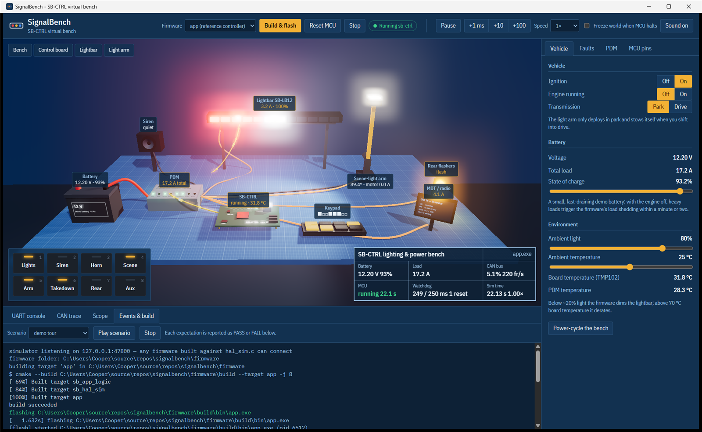

# SignalBench

A virtual hardware bench for embedded firmware. You write ordinary C against a
small HAL, and it drives a simulated emergency-vehicle lighting and power
system rendered in 3D: a CAN-controlled power distribution module with eFuses,
a smart lightbar, a siren, a motorised scene-light arm, rear flashers and a
keypad, with real-world faults you can inject while the firmware runs.



The same firmware binary also runs headless against the plant model, so the
scenarios you watch in the app are the software-in-the-loop tests CI runs.

## What it demonstrates

| Area | Where to look |
|---|---|
| C firmware for an MCU with GPIO, PWM, ADC, timer/encoder, **CAN**, **I²C**, UART, watchdog | `firmware/sdk/include/hal.h`, `firmware/app/` |
| Interface and component design: pure policy modules behind a HAL | `pdm.c`, `power.c`, `arm.c`, `patterns.c`, `siren.c`, `debounce.c` |
| Bare-metal super-loop + cooperative time-triggered scheduler | `firmware/app/main.c`, `scheduler.c` |
| Fault handling: eFuse trip retry with back-off and lock-out, CAN-loss failsafe, stall and encoder plausibility, load shedding with hysteresis, watchdog recovery | scenarios in `firmware/scenarios/` |
| Unit testing (Unity, link-seam fakes for I²C) | `firmware/tests/` |
| Software-in-the-loop integration tests and CI | `sim/core/src/script.rs`, `.github/workflows/ci.yml` |
| Debugging tools: CAN trace with decode, 1 kHz multi-lane scope, UART CLI, single-step time, "freeze world when MCU halts" | the desktop app |

## The bench

```
                 CAN 500 kbit/s
   ┌──────────┐◄──────────────────────┬──────────────────────┐
   │ SB-CTRL  │                       │                      │
   │ your C   │  PWM+DIR   ┌───────┐  │                 ┌────┴──────┐
   │ firmware │───────────►│H-brdg │──┼─► arm motor     │ SB-LB12   │
   │          │◄─ encoder, limit switches, ADC          │ lightbar  │
   │          │─► siren tone, keypad LEDs, beeper       └────▲──────┘
   │          │◄─ keypad (bouncy), ignition, park            │ 12 V
   │          │◄─ TMP102 (I²C)                               │
   └──────────┘                 ┌──────────────┐             │
         12 V ─────────────────►│   SB-PDM8    ├─────────────┘
       battery / alternator     │ 8 × eFuse    ├─► siren amp, scene light,
                                │ CAN node     ├─► arm supply, rear flashers, MDT
                                └──────────────┘
```

* **SB-PDM8** switches eight 12 V outputs on CAN command, reports per-channel
  current, battery voltage and trip/open-load flags, trips on overcurrent
  (250 ms) or short (instant), and **fails safe** if commands stop for 500 ms.
* **SB-LB12** is a 12-head CAN lightbar; flash patterns are generated by your
  firmware, frame by frame.
* The **arm** is a DC gear-motor with back-EMF, inertia, gravity load and a
  self-locking worm drive, an incremental encoder and two limit switches.
* Buttons and limit switches **bounce**; the battery **sags** under load and
  drains with the engine off.

Full message definitions: [docs/CAN_PROTOCOL.md](docs/CAN_PROTOCOL.md).

## Running it

Prerequisites (Windows shown; Linux/macOS work the same with your system
compiler): CMake ≥ 3.16, a C compiler (MinGW-w64 gcc), Rust (stable), Node 18+.

```powershell
# 1. firmware + unit tests
cmake -S firmware -B firmware/build -G "MinGW Makefiles"
cmake --build firmware/build -j
ctest --test-dir firmware/build

# 2. the desktop app (Tauri + three.js)
cd app
npm install
npm run tauri dev
```

In the app, press **Build & flash**. It runs CMake on `firmware/`, launches the
image on the virtual MCU and shows its UART. Then turn the ignition on and use
the keypad (or keys 1–8). To see everything at once, open **Events & build**,
pick **demo tour** and press **Play scenario**.

| Key | Function |
|---|---|
| 1 Lights | warning stage 0 → 1 → 2 → 3 |
| 2 Siren | wail → yelp → phaser → off (only with lights on) |
| 3 Horn | air horn while held |
| 4 Scene | scene light |
| 5 Arm | deploy / stow the light arm (park only; auto-stows in drive) |
| 6 Takedown | white heads steady |
| 7 Rear | rear flashers |
| 8 Aux | clear faults and lock-outs |

The firmware also has a UART command line (`help`, `status`, `pdm`, `tasks`,
`deploy`, `reboot`, and `hang`, which deliberately wedges the CPU so you can
watch the watchdog recover it).

Optional environment variables for demos: `SIGNALBENCH_AUTOFLASH=app` builds
and flashes at start-up; `SIGNALBENCH_AUTOSCRIPT=00_demo_tour` then plays a
scenario.

## Writing your own firmware

Any program that links `sb_hal_sim` becomes a virtual MCU. The smallest one:

```c
#include "hal.h"

int main(void) {
    hal_init();                          /* connect to the bench */
    for (;;) {
        hal_tick_wait();                 /* sleep until the next 1 ms SysTick */
        if (hal_millis() % 500 == 0) hal_gpio_toggle(PIN_LED_HEARTBEAT);
    }
}
```

Add a target in `firmware/CMakeLists.txt` and it appears in the app's
firmware list once you add it to the `<select>` in `app/index.html`
(`blinky` and `pdm_hello` are there as starting points). The HAL is
documented inline in [`hal.h`](firmware/sdk/include/hal.h); pins are in
[`board.h`](firmware/sdk/include/board.h).

Time is **lock-step**: the simulator sends a tick, your code runs, then it
reports its outputs. Simulated time only advances when you call
`hal_tick_wait()`, so a busy loop really does freeze your outputs while the
world keeps going (a moving arm keeps moving into its hard stop), and a
started watchdog really does reset you. Breakpoints in gdb work too; tick
**Freeze world when MCU halts** to stop the world while you are halted.

## Tests

```powershell
ctest --test-dir firmware/build                               # 40 unit tests
cargo test --manifest-path sim/Cargo.toml                     # plant + protocol
cargo build --manifest-path sim/Cargo.toml --release
sim/target/release/sbsim --firmware firmware/build/bin/app.exe `
    --script firmware/scenarios/03_short_retry_lockout.sbs     # one SIL scenario
```

Scenario files are plain text:

```
@0      ignition on
@200    press scene
@1100   fault short 2 on            # harness shorts
@10000  expect uart "LOCKED OUT"    # firmware gave up after 3 retries
@10000  expect pdm.2.duty == 0
```

`sbsim` runs them as fast as the firmware can answer (about 30× real time)
and exits non-zero on any failed expectation. The app plays the same files in
real time and reports each line as PASS or FAIL.

## Layout

```
firmware/
  sdk/        hal.h, board.h, can_db.h, sim_protocol.h, hal_sim.c (Winsock/POSIX)
  app/        reference controller: main.c + pure, tested modules
  examples/   blinky.c, pdm_hello.c
  tests/      Unity unit tests
  scenarios/  SIL scenario scripts (*.sbs)
sim/
  core/       plant model, lock-step engine, supervisor, scenario runner (Rust)
  headless/   sbsim CLI for CI
app/          Tauri desktop shell + three.js bench and debug panels
```

## Design notes and limits

* The firmware runs as a native host process, not on an emulated Cortex-M, so
  it does not exercise real register maps, interrupt latency or code size.
  The HAL boundary is where an STM32 port would go; the logic modules are
  already hardware-independent and unit-tested.
* CAN is modelled at the frame level (no arbitration, bit timing or error
  frames). Bus load is estimated from frame sizes.
* The plant is tuned for clarity, not fidelity: the demo battery holds 4 Ah so
  load shedding happens in a minute or two.

Possible next steps: Cortex-M emulation (Renode or Unicorn) behind the same
protocol, a FreeRTOS build of the controller, a LIN-bus keypad, J1939 vehicle
data from the CAN side.
